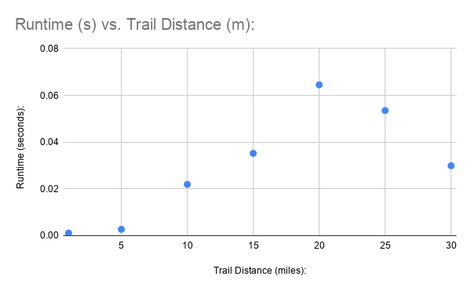

<h1 align="center">Hiking Trails Project</h1>

  In this project, we will be providing the optimal trail for a hiker based on parameters they specify. In this first iteration, we will only be finding trails based on the time the hiker specifies, but in future iterations, we hope to find trails based on accessibility (animals, wheelchairs, bikes, mountain bikes, etc.)

<h3 align = "center">
  What does each file do?
</h3>

<ul>
   <li><strong>depthFirst_prototype.py</strong> - Using all of our other files, this file uses our Depth First algorithm and also incorporates Dijkstra's Algorithm to determine and return some of the best trails for a hiker to take.</li>
   <li><strong>testDictionary.py</strong> - Stores information about each trail (specifically the nodes, the connections, and the length of trails) in the form of a dictionary.</li>
   <li><strong>Runtime.png</strong> - a sample plot from out runtime tests.</li>
 </ul>

<h2 align="center">How to Build</h2>

 <ul>
   <li>Imported External Libraries:</li>
   <ul>
     <li>argparse, heapq, time, Counter, and count</li>
   </ul>
   <li>How to import:</li>
   <ul>
     <li>At the top of your life, write "import" and then the name of the library you would like to use. If you would like a specific part of a library, simply type "from" the name of the library and "import" the part of the library you would like to use.</li>
   </ul>
   <li>Build the graph (build matrix from dict) - The trail dictionary is turned into an adjacency matrix, a grid in which the entry at row a, column b is the trail distance from point a to point
b, and 0 means the two points are not directly connected.</li>
   <li>Distance home (dijkstra to). Dijkstra’s algorithm, a standard shortest-path method,
computes the shortest distance from every trail point back to the start. It runs once, before
the search, and its results are stored in a list so the search can look up “how far is home from
here?” instantly.</li>
   <li>Search (find ranked trails). A depth-first search (DFS) starts at the origin and follows
one trail as far as the rules allow, then backs up (backtracks) and tries the next option, until
every allowed route has been explored. It follows these rules:</li>
   <ul>
     <li>A route may not immediately turn around, except at a true dead end (a point with only
one trail), such as a spur trail.</li>
     <li>A directed trail segment can be used only once.</li>
     <li>A junction can be visited at most twice.</li>
     <li>It abandons (prunes) any step where the distance walked, plus the step, plus the shortest
way home, would exceed the budget. This is where Dijkstra pays off. This check
guarantees that every route the search explores can still get back to the start within the
budget.</li>
   </ul>
   <li>Record. When a loop returns to the start (or at any point, for point-to-point routes), the
route is scored and added to a list of the best 25 routes. That list is kept as a heap, a structure
that makes it cheap to find and drop the current worst entry when a better route arrives. A
route and its exact mirror image count as one.</li>
   <li>Score (score route). It computes the new nodes, fresh miles, and repeat miles described
above. Routes are compared on new nodes first, then fresh miles, then fewer repeat miles.</li>
   <li>Prune and cap. Once the best-25 list is full, the branch-and-bound step estimates the most
new nodes a branch could still reach, counting every unvisited point that is reachable with
the remaining distance. If that best case is lower than the 25th-best route’s count, the branch
is skipped. Because the estimate is optimistic, skipping a branch never discards a route that
could have made the list. The call and time caps guarantee the search stops.</li>
   <li>Results (show). It formats the results according to their score.</li>
 </ul>

 <h2 align="center">Running Tests</h2>

 <ul>
   <li>Update preferred hike length via "budget" variable in the main function call in "depthFirst.py"</li>
   <li>Update preferred starting point via "origin" variable in the main function call in "depthFirst.py"</li>
   <li>Run "depthFirst.py"</li>
 </ul>

 <h2 align="center">Producing Plots</h2>
 
 

   
 

 <ul>
   <li>Using "time":</li>
   <ul>
     <li>Import "time" at the beginning of the file that will be running your code in. In the main function, before the search for the perfect trail begins, define the starting time as something like "t0 = time.perf_counter()". At the end of the main function find the total amount of time taken to run this code using a function like "time.perf_counter() - t0:.4f".</li>
   </ul>
   <li>Change Hiking Distance:</li>
   <ul>
     <li>The intended hiking distance is defined in the parse_args function. Change this variable to the desired distance and see how the distance affects the runtime of the algorithm.</li>
   </ul>
 </ul>
